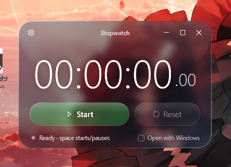

# Stopwatch Liquid Glass for Windows 10

A tiny stopwatch for Windows 10 with an Apple "Liquid Glass"-style interface, built for one job:
**never lose your time, even if the PC shuts down suddenly.**

<p align="center">
  
</p>

While it runs, the elapsed time is written to disk every half second. If the power goes out or
Windows crashes, the next time you open it the stopwatch comes back **paused at the last saved
time**. Press *Resume* and it picks up where it left off.

## Features

- **Survives sudden shutdowns:** at most ~0.5 s is lost on a power cut.
- **Glass interface:** real Windows blur behind the window, translucent tint, specular rim, pill buttons.
- **Native window animations:** minimize, maximize and restore use the standard Windows 10 animations.
  Aero Snap and the system menu work too.
- **Maximize:** the time scales up to fill the screen.
- **Safe reset:** *Reset* asks for a second click to confirm.
- **Two layers** (optional): turn on *Two layers* in the ⚙ menu to get two independent stopwatches,
  e.g. "Work" and "Gaming". Each one keeps its own time and can run at the same time as the other.
  Double-click a layer's tab (or use *Rename layer* in the ⚙ menu) to rename it.
- **English and Portuguese:** on first launch it follows the Windows display language
  (Portuguese for `pt-*`, otherwise English). You can switch any time from the ⚙ gear in the top-left corner.
- **Open with Windows** (optional): one click registers it to start when you log in.
- **Lightweight:** a single ~330 KB `.exe`, no installer, no dependencies beyond the .NET Framework
  already included in Windows 10. Uses almost no CPU while paused.

Keyboard: <kbd>Space</kbd> starts or pauses.

## Download

Get `Stopwatch.exe` from the [latest release](https://github.com/joaosouli/Stopwatch-Liquid-Glass-for-Windows-10/releases/latest)
and run it. There's no installer.

The executable isn't code-signed, so Windows SmartScreen may show "Windows protected your PC" the
first time. Click **More info → Run anyway**, or build it yourself from source (see [Build](#build)).

## Uninstall

1. If you turned on *Open with Windows*, turn it off from the app first (this removes its entry from
   `HKCU\Software\Microsoft\Windows\CurrentVersion\Run`).
2. Close the app and delete `Stopwatch.exe`.
3. Delete the folder `%LOCALAPPDATA%\CronometroGlass` to remove the saved time and settings.

## How the time is saved

The state lives in `%LOCALAPPDATA%\CronometroGlass\estado.bin`, a 128-byte file with **two slots**
that are written alternately. Writes use `FileOptions.WriteThrough` plus `Flush(true)`, so they go
straight to disk and don't sit in the Windows cache. Each slot has a sequence number and a CRC32.
On startup the valid slot with the highest sequence wins, so a power cut in the middle of a write
can never corrupt the saved time. The second layer uses the same format in `estado2.bin`.

If the last saved state says "running", the app knows it didn't close normally. It restores that
time paused and shows *Recovered* with the date and time of the last save.

A normal Windows shutdown, sleep, or closing the app also pauses the stopwatch and saves.

## Build

You don't need Visual Studio. The C# compiler that ships with Windows (.NET Framework 4.x) is enough:

```powershell
powershell -ExecutionPolicy Bypass -File .\build.ps1
```

This produces `Stopwatch.exe` next to the script. Everything is in a single source file,
[`src/Cronometro.cs`](src/Cronometro.cs): WPF with the UI written as inline XAML.

Every push is also built by [GitHub Actions](.github/workflows/build.yml) on a GitHub-hosted
Windows runner, and the resulting `.exe` can be downloaded from the run's artifacts.

## Requirements

- Windows 10 (version 1803 or later for the blur effect)
- .NET Framework 4.5+ (preinstalled on Windows 10)

## Privacy

The app never connects to the internet or any network, and collects no data. It only writes to your own computer: the saved time and settings in `%LOCALAPPDATA%\CronometroGlass`,
and, only if you turn on *Open with Windows*, one value under
`HKCU\Software\Microsoft\Windows\CurrentVersion\Run`.

## License

[MIT](LICENSE)
